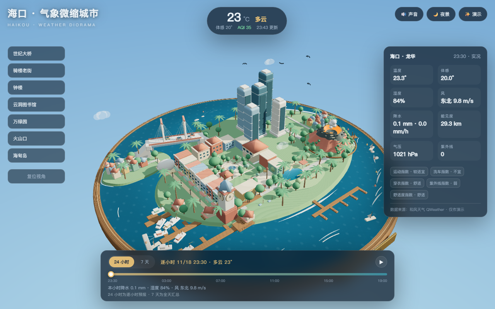

# 海口 · 气象微缩城市（Q 版）

一座能在浏览器里转着看的 Q 版海口微缩城，接入**和风天气**的真实数据：实况、24 小时、7 天预报、AQI、预警、生活指数；雨、云、阳光、雾、风都会直接作用在场景里。双击 `start.cmd` 即可运行。



## 快速开始

```powershell
# 方式一：双击 start.cmd，选择 [1] 仅本机 / [2] 本机+手机局域网
start.cmd

# 方式二：命令行（仅本机）
node server.mjs
# 浏览器打开 http://127.0.0.1:8787

# 方式二·局域网（手机同 WiFi 访问）
set HOST=0.0.0.0 && node server.mjs
# 手机打开 http://<本机IPv4>:8787（用 ipconfig 查 IP）
```

凭据放在 `.env.qweather`（已 gitignore，不会进前端）：

```
QW_API_HOST=xxxxxx.qweatherapi.com
QW_API_KEY=...
```

`GET http://127.0.0.1:8787/api/health` 可检查服务与凭据状态。
静态服务只放行 `/app/`、`/assets/`、`/vendor/`，密钥文件不会通过 HTTP 暴露。

## 当前状态（v1.0）

| 模块 | 状态 |
| --- | --- |
| 和风天气接入 | ✅ 10/10 接口实测通过（实况 / 逐小时 / 每日 / AQI / 预警 / 指数） |
| 服务端代理 + 10min 缓存 + 快照降级 | ✅ |
| Three.js 场景（圆形底座 + 7 地标） | ✅ 105,793 tris / 24 材质 / 5.16 MiB |
| 车流 / 渔船 / 飞鸟 / 椰树 / 海面动画 | ✅（车流 `?qa=1` 实测 0 越界） |
| 天气映射（晴/云/雨/雷/雾、昼夜、风） | ✅ |
| 24h/7d 时间轴、地标点击、演示模式 | ✅ |
| 程序化音效（默认开启） | ✅ 手机听感已确认 |
| 移动端 390×844 | ✅ 真机触摸/布局/复位视角均通过 |
| 海面 z-fighting | ✅ 真机旋转复测通过，无沙色/绿色穿出 |
| 性能 | ⚠️ 无头 SwiftShader 20fps / 183–204 calls / 108.6k tris；真实 GPU 未做量化测试 |
| 资产终验 | ✅ 105,793 tris / 819 网格 / 24 材质 / glb-audit PASS |

## 关键文件

```
start.cmd                         一键启动（含局域网模式）
server.mjs                        静态服务 + 和风代理（KEY 仅服务端，白名单放行）
app/index.html                    页面与 importmap
app/src/main.js                   场景/天气/时间轴/交互
app/src/city.js                   GLB 加载、静态网格合并、动画 rig
app/src/effects.js                天空/海面/雨/飞鸟/闪电
app/src/ui.js                     HUD/卡片/时间轴/地标卡
app/src/sound.js                  WebAudio 程序化音效
assets/models/haikou_v1.glb       微缩城市资产
tools/blender/build_haikou_v1.py  资产生成脚本
tools/qweather-probe.mjs          和风天气全接口探测
docs/report-v1.md                 验证报告与方案
docs/app-report.md                应用验收记录（含 P0 回归 / P1 打磨 / 各项修复）
docs/asset-report.md              资产统计与命名
data/app/                         验收截图
```

## 交互

- 拖拽旋转、滚轮缩放、双击/「复位视角」回全景。
- 左侧（手机端底部横滚栏）7 个地标：镜头推近 + 天气卡。
- 底部 24 小时 / 7 天时间轴：拖动看光照与天气变化；▶ 自动播放。
  - 24h 为逐小时预报，7d 为全天汇总，界面有明确标注。
- 右上：声音开关、昼夜切换、天气演示（晴→多云→小雨→雷雨→雾）。
- QA：`?wx=rain|thunder|fog|night|sunny` 强制天气；`?qa=1` 桥面越界数字；`?fps=1` 帧率；`?audio=1` 音频增益。
- 多角度复现：`?az=<0..359>&elev=<高度>&dist=<半径>` 固定机位，例：`?az=150&elev=60&dist=245`。用于精确反馈某个角度的问题。

## 在线版 / GitHub Pages

在线版没有服务端代理，因此**天气数据需要你自己的和风天气 KEY**：

1. 到 [和风天气控制台](https://console.qweather.com/setting) 免费创建应用，拿到 **API Host** 和 **KEY**（注意是账号专属 Host，不是 `devapi.qweather.com`）
2. 打开页面，点右上角 **⚙ 密钥**，填入两项，点「保存并获取天气」
3. KEY 只存在你自己的浏览器 localStorage，不会上传、不进仓库；刷新后自动直连
4. 「清除」可删除本机 KEY

和风 API 允许浏览器跨域直连（CORS `*`），所以在线版同样能显示真实天气。本地 `start.cmd` 模式仍走服务端代理，用 `.env.qweather` 里已配好的 KEY，不需要在页面里填。

> KEY 以明文存于本机浏览器，请勿在公用电脑保存。

## 复现资产

```powershell
& 'D:\DeepSeek Harness WorkSpace\blender-bridge\blender\blender-5.2.3-windows-x64\blender.exe' `
  --background --factory-startup --python tools/blender/build_haikou_v1.py
```

## 数据与署名

天气数据来源：和风天气 QWeather。界面固定标注；仅用于本演示项目。
