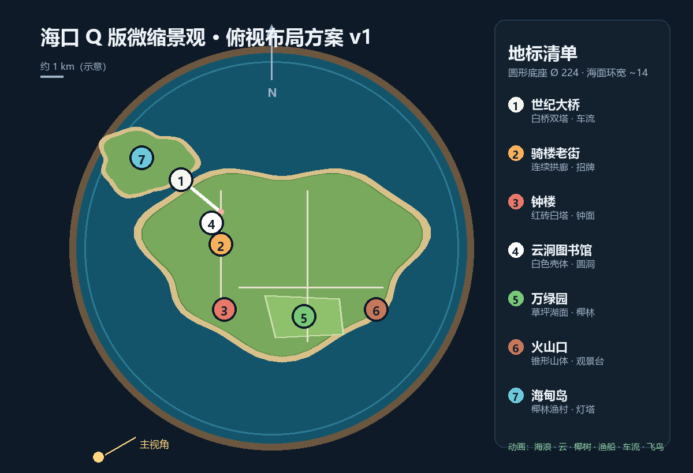

# 海口天气微缩城市 · 验证报告与实施方案 v1

> 2026-11-17 · 状态：**待你确认，确认后才开工**
>
> 本报告包含两部分：① 和风天气实测验证结果；② Q 版圆形微缩景观 + 生命力动效的完整方案。

---

## 0. 结论摘要

| 问题 | 结论 |
| --- | --- |
| 和风天气能否查海口（含预报） | **能。10/10 接口实测通过**：实时、240 小时逐小时、10 天每日、AQI、预警、生活指数全部可用 |
| 需要什么 | 你给的 KEY + API Host 已生效；关键是 **API Host 必须使用账号专属域名**（旧公共域名已 403） |
| 建模方向 | 圆形岛屿底座 + 7 个地标 + 海面环，Q 版玩具质感（见布局图） |
| 生命力 | 三层动效：常驻生命（海浪/云/椰树/渔船/车流/飞鸟）+ 天气驱动 + 交互反馈；每个镜头至少 3 种不同频率的运动 |
| 当前进度 | 决策已拍板，正式开发中（资产 + App 并行） |

**最终决策（2026-11-17 已确认）**
- 布局：**V1**（底座 Ø224、独立海甸岛、桥跨海）；密度按 V2 手法补足。
- 地标：世纪大桥、骑楼老街、钟楼、云洞图书馆、万绿园、火山口、海甸岛。
- 动画优先级：**车流、渔船、飞鸟**（必须惊艳），其余合格即可。
- 交互：点击地标 + 24h/7d 时间轴 + 昼夜 + 天气演示，四项全要。
- 音频：**默认开启**（首次点击解锁），可静音。
- 交付：本地网页 + `start.cmd`，桌面优先、移动端基础适配。
- 分工：Lead＝PM/QA；编码＝GPT-6.1-SOL(max) 子代理；Lead 负责集成与兜底修补。

---

## 1. 和风天气验证报告

### 1.1 凭据与坐标

- API Host：`xxxxxxxx.qweatherapi.com`（已写入本地 `.env.qweather`，不进 git）
- 凭据 ID：`KF5AK2F58E`；开发者 ID：`Q138E6BC10`；API KEY 已本地保存（不在此文档重复）
- 鉴权方式：请求头 `X-QW-Api-Key`，服务端代理调用，浏览器不接触 key
- **海口 LocationID：`101310101`**（GeoAPI 实测）。区级：龙华 `101310103`、美兰 `101310105`、秀英 `101310102`
- 天气查询坐标：`20.04, 110.34`（骑楼老街/钟楼 waterfront）
  - 注意：GeoAPI 里“海口”这个城市记录的中心点显示为 `20.04581, 110.19842`，比实际市中心偏西约 15 km。**应用统一用经纬度查询**，不用城市 ID 的中心点。

### 1.2 实测结果（2026-11-17 19:12，真实返回）

| 接口 | 结果 | 耗时 | 数据样例 |
| --- | --- | --- | --- |
| GeoAPI 城市搜索 | ✅ 200 | 397 ms | 海口/101310101、美兰/101310105、秀英/101310102 |
| GeoAPI 坐标反查 | ✅ 200 | 93 ms | 龙华/101310103 |
| 实时天气 | ✅ 200 | 86 ms | 晴 26.9°C，体感 26.1°C，湿度 77%，东南风 7.2 m/s（4 级），云量 18%，能见度 30 km |
| 逐小时 24h | ✅ 200 | 101 ms | 24 条，首条 20:00 晴间多云 26.2°C |
| 每日 3 天 | ✅ 200 | 86 ms | 17 日小雨 23~30°C；18 日小雨 24~29°C；19 日阴 22~25°C |
| 每日 7 天 | ✅ 200 | 110 ms | 11-17 ~ 11-23 完整 |
| 每日 10 天 | ✅ 200 | 102 ms | **10 天全部返回**（免费计划上限不是 7 天） |
| 空气质量 | ✅ 200 | 77 ms | AQI 20「优」，无首要污染物 |
| 灾害预警 | ✅ 200 | 78 ms | 0 条生效预警（`zeroResult: true`） |
| 生活指数 | ✅ 200 | 79 ms | 运动较不宜 / 洗车较不宜 / 穿衣热 / 紫外线弱 / 舒适度较舒适 |

补充实测：
- **逐小时最多 240 小时**（10 天），每日最多 10 天；
- 每日预报自带 `astro`：日出 06:48、日落 17:58、月相、太阳正午，可直接驱动场景光照；
- 实时数据自带露点、气压、UV、阵风，够做“体感”和天气氛围。

### 1.3 接口清单（已实测）

| 能力 | 请求路径 |
| --- | --- |
| 实时天气 | `GET /weather/v1/current/{lat}/{lon}?localTime=true&lang=zh` |
| 逐小时 | `GET /weather/v1/hourly/{lat}/{lon}?hours=240&localTime=true&lang=zh` |
| 每日 | `GET /weather/v1/daily/{lat}/{lon}?days=10&localTime=true&lang=zh` |
| 空气质量 | `GET /airquality/v1/current/{lat}/{lon}?lang=zh` |
| 灾害预警 | `GET /weatheralert/v1/current/{lat}/{lon}?lang=zh` |
| 生活指数 | `GET /v7/indices/{1d|3d}?type=1,2,3,5,8&location={lon},{lat}&lang=zh` |
| 城市/坐标反查 | `GET /geo/v2/city/lookup?location=海口` 或 `location={lon},{lat}` |

字段注意：预报返回数组名是 `hours` / `days`（不是 `hourly` / `daily`），文档示例与新版返回结构有差异，这一点已修正进探测脚本。

### 1.4 数据 → 场景映射潜力

| 天气数据 | 场景表现 |
| --- | --- |
| condition.code（晴/多云/阴/雨/雷/雾/雪） | 天空颜色、云量、雨雪粒子、闪电、雾气 |
| temperature / feelsLike | 色调冷暖、阳光强度、空气热浪（高温） |
| humidity | 水汽感、远景朦胧度 |
| wind.speed / direction / scale | 雨丝倾角、椰树摆动幅度与方向、海浪大小、云移动速度、风车/旗帜 |
| precipitation.intensity / type | 雨滴数量与速度、地面积水、雨声 |
| cloudCover | 云层密度与阴影 |
| visibility | 雾浓度、远景淡出 |
| uvIndex | 阳光强度与高光 |
| astro.sunrise/sunset | 昼夜光照、太阳/月亮位置 |
| AQI / category | 远景空气通透度、HUD 色带 |
| alerts | 顶部预警条、场景紧张感（台风时海浪/风加大） |

### 1.5 工程约束

- **KEY 只在服务端**：本地 `server.mjs` 代理 `/api/weather/*`，注入 `X-QW-Api-Key`；前端只拿 JSON。
- **缓存**：实时 10 分钟、逐小时 30 分钟、每日 1 小时、AQI 30 分钟、预警 5 分钟、指数 6 小时；缓存落盘，断网时用最近快照，App 不会白屏。
- **署名**：界面固定显示“数据来源：和风天气 QWeather”。
- **配额**：以你账号套餐为准；免费计划有 QPM/日调用上限，缓存策略就是为此设计。2027-01-01 起 API KEY 每日请求量会被限制，长期可换 JWT（Ed25519，需在控制台上传公钥）。
- **CORS**：不依赖浏览器直连，避免跨域与 key 泄露。

### 1.6 风险

1. 预报本身有不确定性，尤其海口午后的对流雨；UI 需标注“预报”而非“实况”。
2. 预警数据可能延迟，以官方发布为准（API 自带提示）。
3. 免费额度/限流，需缓存与错误降级。
4. 城市中心点偏移问题（已用坐标规避）。

---

## 2. Q 版微缩城市方案

### 2.1 视觉方向

- **关键词**：盲盒 / 微缩模型 / 等距插画 / 暖色木头底座 / 马卡龙但不脏。
- 圆形岛屿底座（Ø 224 世界单位），外圈木纹托盘 + 海面环，正面可加铜牌 `HAIKOU · 20.04°N 110.34°E`。
- 主视角：西南方向 35° 俯视，轻微移轴景深（近处清晰、远处微虚），像拍摄桌上的模型。
- 光照：暖白主光 + 天光补光，长而柔的阴影；夜景为月光 + 城市灯火。

### 2.2 布局（俯视方案）



| # | 地标 | 位置意图 |
| --- | --- | --- |
| 1 | 世纪大桥 | 左前景，斜跨海湾连接海甸岛，作为画面第一视觉 |
| 2 | 骑楼老街 | 西侧水岸，连续拱廊面向海 |
| 3 | 钟楼 | 老街南端收头 |
| 4 | 云洞图书馆 | 西岸白色壳体，桥与老街之间 |
| 5 | 万绿园 | 右前景大草坪 + 湖面 + 椰林 |
| 6 | 火山口 | 右后景锥形山体，形成天际线变化 |
| 7 | 海甸岛 | 左上小岛，渔村 + 灯塔 + 椰林 |

### 2.2.1 紧凑度标准（专门解决“空旷感”）

**最终采用 V1 布局**（你已拍板）。V1 的地标位置与“桥跨海 + 独立海甸岛”构图冻结，但**密度必须补足**，否则按 V1 示意图直接做会空（陆地只占底座约 31%，岛心有直径约 50 的空绿）。

执行方式：**V1 版面 + V2 的密度手法**——地标位置不动，只做三件事：

1. 底座保持 Ø224，主岛放大到约 170×125（仍在 V1 构图内）；
2. 岛心加老城街块网格 40+、CBD 4–5 栋、椰林 60+、道路与步道，填掉空绿；
3. 西南海面加码头 3 组 + 渔船 9 艘 + 防波堤 + 帆船 3 艘，海面不空。

| 指标 | V1 示意图 | V1 + 密度（施工目标） |
| --- | --- | --- |
| 陆地占底座面积 | ~31% | **≥ 45%** |
| 海面环宽 | 30–40 | **25–30**（保留 V1 的“海上托盘”感） |
| 岛内内容覆盖 | ~30% | **≥ 65%** |
| 7 地标位置 | 冻结 | 不移动 |
| 空地处理 | 大块草坪 | 街块/椰林/绿丘/小广场过渡 |
| 海面填充 | 只有水 | 码头、防波堤、渔船、帆船、桥墩 |
| 验收 | — | M2 灰度密度图 + 主视角检查，任意 15% 画面不得只有单一色块 |

V2 图（[layout-plan-v2.png](layout-plan-v2.png)）保留作为“密度参考”，不作为布局依据。

### 2.3 地标还原规格（Q 版 = 比例夸张，不是细节省略）

| 地标 | 必须保留的识别特征 | Q 版处理 | 面数预算 |
| --- | --- | --- | --- |
| 世纪大桥 | 双塔、斜拉索扇形、主跨/边跨、桥面栏杆、车流 | 塔加粗、索加粗、桥面微拱 | ≤ 30k |
| 骑楼老街 | 连续拱廊、7–9 开间、二三层窗、女儿墙、山花、招牌、遮阳棚 | 开间放大、颜色分区 | ≤ 25k |
| 钟楼 | 红砖基座 + 白塔身 + 四面钟 + 攒尖顶 + 分段比例 | 塔身略短、钟面放大 | ≤ 10k |
| 云洞图书馆 | 白色有机壳体 + 3 个圆洞 + 临水 | 壳体更圆润 | ≤ 8k |
| 万绿园 | 大草坪、湖面、步道、椰林、风筝/帐篷 | 草坪起伏、湖面反光 | ≤ 15k |
| 火山口 | 锥形山体 + 火山口 + 观景台 + 绿坡 | 山体压低、火山口放大 | ≤ 12k |
| 海甸岛 | 渔村小屋、灯塔、椰林、沙滩 | 房屋成组、灯塔加大 | ≤ 10k |
| 底座/海面/道路/树木 | — | — | ≤ 40k |
| **合计** | | | **≤ 150k 三角面** |

### 2.4 生命力系统（避免“木头感”）

**设计原则：每个镜头里，至少 3 种不同频率、不同相位的运动同时存在。**

#### A. 常驻生命（不依赖天气，永远在动）

| 元素 | 运动 | 频率/幅度 |
| --- | --- | --- |
| 海面 | 顶点波浪 + 高光闪烁 + 岸边泡沫呼吸 | 0.08–0.2 Hz，波高 0.3–1.0 |
| 云 | 整组缓慢漂移 + 轻微上下浮 | 0.01 Hz，横向 0.5–2 u/s |
| 椰树 | 树干轻摆 + 叶片相位错开的摆动 | 0.3–0.6 Hz，±2°–6° |
| 渔船 | 随波起伏 + 缓慢巡航 / 转向 | 0.2 Hz 起伏，0.3 u/s |
| 桥上车流 | 双向车流沿桥面移动，夜间开车灯 | 1.2–2.5 u/s |
| 飞鸟 | 3–5 只绕岛盘旋，翅膀拍动 | 0.5 Hz 拍翅，绕行 20–30 s 一圈 |
| 灯塔 | 光束 360° 旋转（夜间） | 8 s/圈 |
| 招牌/遮阳棚 | 轻微摆动 / 布料波动 | 0.4 Hz，±1.5° |
| 行人/骑楼街 | 极小比例的小人偶走动（可选） | 0.5 u/s |

#### B. 天气驱动（由和风天气 API 决定）

| 天气 | 场景反应 |
| --- | --- |
| 晴 | 强定向光、清晰阴影、海面高光、UV 高时高光更强 |
| 多云/阴 | 云量增加、光变柔、阴影变淡、天空去饱和 |
| 小雨/中雨/大雨 | 粒子雨（数量/速度/长度随 intensity）、雨丝随风倾斜、地面积水反光、雨雾 |
| 雷阵雨 | 上述 + 随机闪电（照亮全城 0.1s）+ 延迟雷声（可选） |
| 雾 | 距离雾 + 降低远景对比，桥塔半隐 |
| 大风/台风预警 | 椰树大幅摆动、雨丝倾斜 30°+、海浪增高、云快速移动、UI 预警条 |
| 夜间 | 太阳落山后切换月光 + 城市灯光、桥索灯带、渔船灯 |
| 高温 | 空气热浪扭曲（轻微）、地面反光更强 |

#### C. 交互反馈（人一动，城市就有回应）

- 拖拽旋转：带惯性阻尼，松手后缓慢停下；自动旋转可开关。
- 悬停地标：地标轻微上浮 / 高亮描边 + 名称标签。
- 点击地标：镜头平滑推近，弹出该地标的天气卡（如“世纪大桥 · 东南风 4 级”），再点返回全景。
- 时间轴：24 小时 / 7 天，拖动时光照、云、雨、温度同步变化（不是简单切图，是插值）。
- 昼夜切换：一键看夜景（灯光 + 月光）。
- 演示模式：循环播放“晴 → 多云 → 雨 → 雷雨 → 雾”的天气秀，用于展示（数据为模拟，UI 明确标注）。
- 迷你“体感”彩蛋：点击海面溅起水花、点击椰树摇一下、点击桥面汽车鸣笛（可选音效，默认静音）。

### 2.5 交互与信息架构

```
全景视角
 ├─ 顶部：海口 · 实时 26.9°C 晴 | 数据来源
 ├─ 左侧：24h / 7d 时间轴（拖动）
 ├─ 右侧：天气卡（温度/体感/湿度/风/降水/AQI/预警）
 ├─ 底部：地标快捷按钮（桥/老街/钟楼/云洞/万绿园/火山口）
 └─ 点击地标 → 推近 + 该地标天气卡 + 小知识（如“世纪大桥主跨 340m”）
```

### 2.6 技术架构

```
Blender（参数化脚本）──► GLB（≤150k tris，节点命名规范）
        │
        ▼
Three.js 场景（无构建步骤，本地 vendor）
  ├─ GLTFLoader 载入城市
  ├─ OrbitControls（阻尼、自动旋转、点击拾取）
  ├─ 自定义海面 Shader（波浪/高光/泡沫）
  ├─ 天空 Shader（昼夜渐变 + 太阳/月亮）
  ├─ 粒子系统（雨/雪/雾/闪电/鸟）
  ├─ 动画系统（椰树/云/船/车/灯，基于时间 + 相位）
  └─ UI 层（HUD/时间轴/地标卡）
        │
        ▼
Node server.mjs（静态服务 + /api/weather 代理 + 磁盘缓存）
        │
        ▼
和风天气 API（KEY 仅服务端）
```

- 不引入 npm 依赖，three.js 与 addons 已本地化（`vendor/`）。
- 启动：`start.cmd` 双击 → 打开 `http://127.0.0.1:8787`。
- 资源全部本地，断网可展示最近缓存 + 演示模式。

### 2.7 性能与质量门槛

- 桌面 60 fps / 移动 30 fps；DPR 上限 2；粒子数量按设备分档。
- 首屏 ≤ 3 s（本地）；GLB ≤ 8 MB。
- 地标验收：3 个角度渲染 vs 实景照片，缩略图尺寸仍可辨识。
- 动效验收：任意截图间隔 2 s，画面必须有可感知变化；同一镜头 ≥3 种运动。
- 天气验收：condition.code 与画面表现一一对应（雨/晴/阴/雾/雷至少 5 种截图）。
- 数据验收：HUD 数字与 API 返回一致，时间轴与预报对齐。

### 2.8 里程碑（每步都有可视产物，你确认后再进下一步）

| 阶段 | 产物 | 验收点 |
| --- | --- | --- |
| M1 方案确认 | 本报告 + 布局图 | 你拍板 |
| M2 资产 v1 | 圆底座 + 7 地标 GLB + 3 角度预览 | 造型/比例/辨识度 |
| M3 场景生命力 | 可旋转场景 + 常驻动效 | 不木头、不卡 |
| M4 天气接入 | 真实数据 + 天气动效 + 时间轴 + HUD | 数据正确、表现对应 |
| M5 打磨交付 | 多天气截图、性能、启动脚本、说明 | 完整可运行 |

---

## 3. 需要你确认（确认后我才开工）

1. **布局**：接受图中的 7 点布局吗？特别是火山口放右后景、万绿园放右前景、桥在左前景。
2. **底座**：Ø224 圆盘 + 木纹边 + 正面铜牌 `HAIKOU 20.04°N 110.34°E`，可以吗？
3. **生命力优先级**：雨、风、云、车流、渔船、飞鸟——哪 3 个必须做到“一眼惊艳”？（其余做到合格）
4. **交互深度**：点击地标推近 + 天气卡、24h/7d 时间轴、昼夜切换、天气演示模式，这四项是否全要？
5. **交付形态**：本地网页 + `start.cmd`（推荐，无需安装）？是否要手机端适配？
6. **音效**：是否需要雨声/海浪/风声音效（默认静音，可开关）？

## 4. 明确不做（避免预期错位）

- 不做真实城市级 GIS 等比还原（你已确认要 Q 版挑地标）。
- 不做写实材质/照片级渲染。
- 不做多城市切换（可预留数据结构）。
- 不做账号/云端部署（先本地运行）。

---

*附：验证脚本 [tools/qweather-probe.mjs](../tools/qweather-probe.mjs)（可随时复跑）；数据快照 [data/qweather/snapshot-haikou.json](../data/qweather/snapshot-haikou.json)；布局图 [docs/layout-plan.png](layout-plan.png)。*
